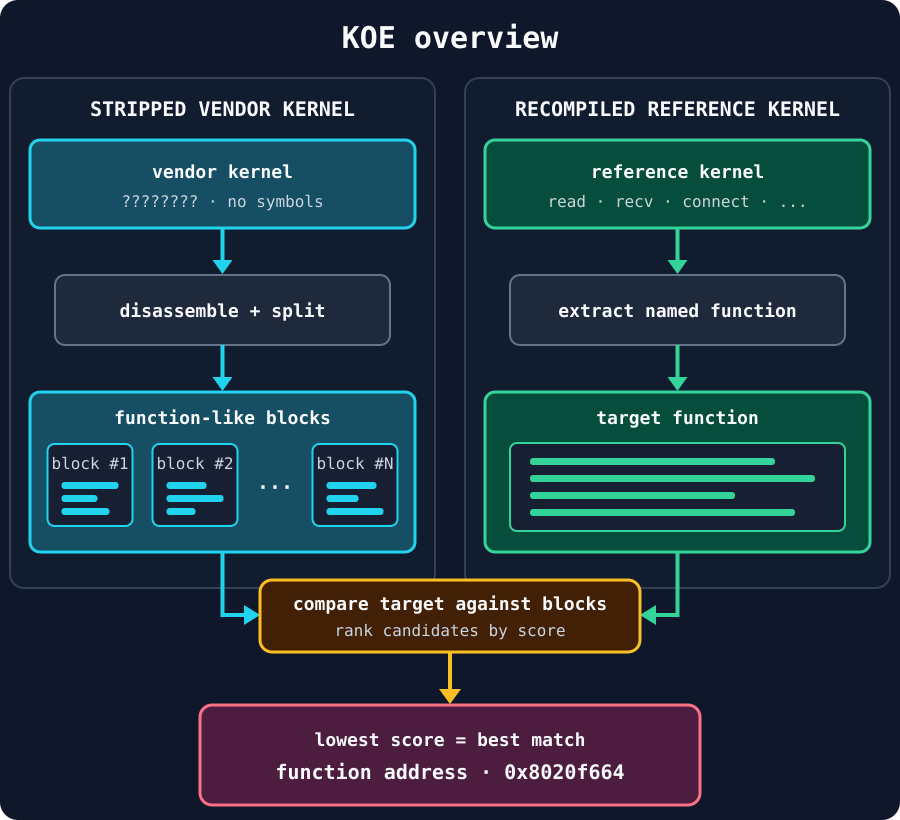
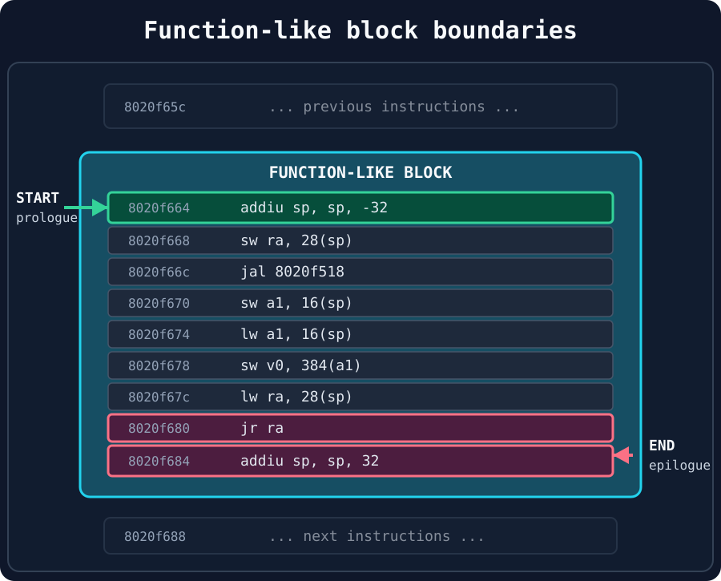
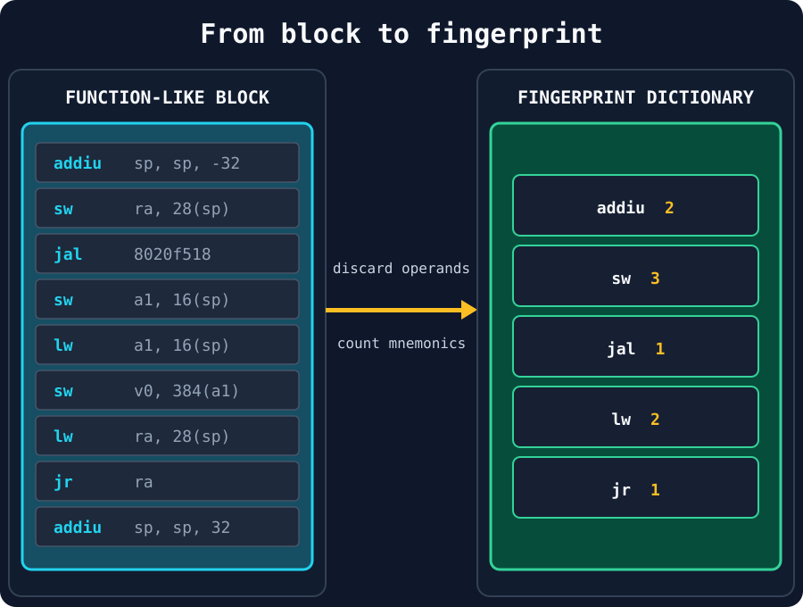
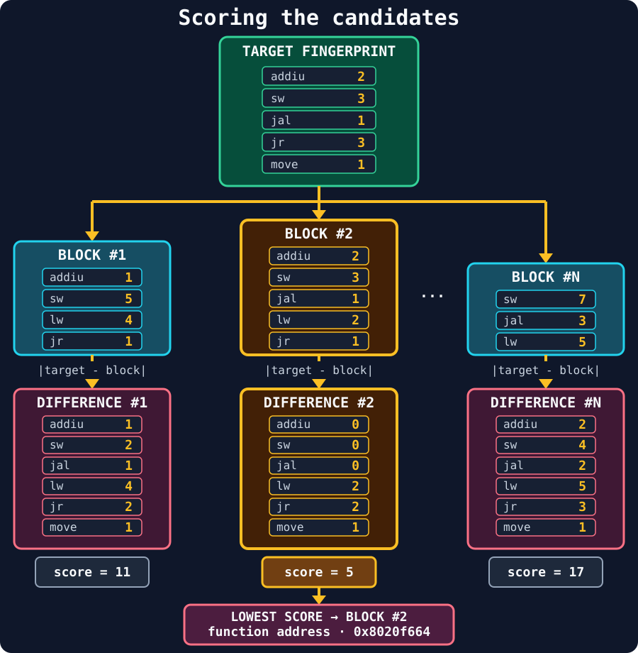

## Introduction

While developing CFuzz, I was trying to emulate on QEMU Linux kernels extracted directly from some vendor's firmware images. Keeping the vendor kernel can be useful, because it preserves the behavior of the real device, including its patches and drivers. Unfortunately, firmware images rarely come with a symbol table or debugging information. They may also be packed or encrypted in weird vendor-specific format.

Since we want to know where certain functions in the kernel are, this becomes a problem. CFuzz, for example, hooks system calls such as `read`, `recv`, and `connect` to detect when a process is ready to consume an input. QEMU needs an address at which to place that hook, but in a stripped kernel we don't know anymore where those functions are.

If I recompile the kernel, the solution is straightforward: enable debug information and obtain the symbol addresses with tools such as `readelf` or `objdump`. However, the interesting case is when the original vendor kernel boots correctly in QEMU and I don't want to replace it.

That is the problem KOE (the Kernel Offset Extractor) tries to solve.

## The main idea

Stripping a binary removes its names and debugging metadata, but it does not remove the code instructions. The compiled implementation of a function is still there; we just do not know which block of instructions belongs to which function.

KOE uses a second kernel as a reference. I compile a kernel with a version and configuration as close as possible to the one extracted from the firmware image, this time keeping its symbols. Using `objdump`, I can then extract the assembly of the function I am looking for from the recompiled kernel and then compare it with every function-like block found in the stripped kernel.

The complete pipeline looks like this:



KOE answers a narrower question: *which block in this stripped kernel most closely resembles this known function?*

## Finding function boundaries, the blocks

The first step is to turn one large disassembly into a list of candidate functions or blocks. Compilers usually emit recognizable function prologues and epilogues. Reverse-engineering tools (like IDA) use several heuristics to recover function boundaries when symbols are unavailable.

The exact pattern is architecture-dependent. On MIPS, for example, a common function prologue looks like this:

```asm
addiu sp, sp, -32
```

KOE disassembles the raw kernel, finds occurrences of that pattern, and starts a new block at each occurrence. In simplified Python, the splitting logic is:

```python
def split_chunks(assembly, prologue_pattern):
    chunks = []
    current_chunk = []

    for line in assembly.strip().splitlines():
        if prologue_pattern.search(line) and current_chunk:
            chunks.append("\n".join(current_chunk))
            current_chunk = []

        current_chunk.append(line)

    if current_chunk:
        chunks.append("\n".join(current_chunk))

    return chunks
```

For example, one recovered block may look like this:



## Building a function fingerprint

Comparing raw bytes would be too strict. Instead, KOE discards operands and counts instruction mnemonics. The block above becomes:



The same transformation is applied to every candidate block in the stripped kernel and to the target function extracted from the recompiled kernel. Because the recompiled kernel contains symbols, its block can be obtained directly with a command such as:

```bash
mips-linux-gnu-objdump --disassemble=FUNCTION_NAME RECOMPILED_KERNEL
```

The result is a compact fingerprint: a histogram describing which kinds of instructions the function contains and how frequently each one appears. Ignoring operands makes the comparison tolerant of changed addresses and immediate values.

## Scoring the candidates

Let `T` be the fingerprint of the reference function and `C` the fingerprint of a candidate. KOE computes the absolute difference for every mnemonic present in either block and sums the results:

```text
score(T, C) = sum(abs(T[opcode] - C[opcode]))
```

Lower values indicate a closer match, a score of zero would indicate a perfect match. KOE performs this comparison against every function-like block:



In this example, block `#2` has the lowest score, `5`, so it becomes the closest candidate. The address of its first instruction is the candidate function address.

Once the kernel has been disassembled and fingerprinted, searching for another function only requires extracting one reference block and comparing small dictionaries.

## Why the reference build matters

The quality of the match depends heavily on the reference kernel. Ideally, it should use:

- the same Linux version;
- the same architecture and endianness;
- a similar kernel configuration;
- the same compiler family and version;
- equivalent optimization options.

In practice, vendor build environments are often unavailable. A kernel built from the corresponding source version with a standard or recovered configuration can still provide a useful template. Configuration changes may enable different code paths, compiler versions may select different instructions, and vendor patches may alter the target function itself.

One way to reduce this dependency is to generate several reference builds with different compiler versions or optimization settings. If the same candidate consistently ranks first across multiple templates, that is much stronger evidence than a single low score.

## Validating a match

The block with the best score is just a candidate, not a proof. I validate an extracted offset before relying on it:

1. Inspect the top candidates rather than looking only at the first one. A large gap between the best and second-best scores is more convincing than several ties.
2. Compare the surrounding instructions and calls. Even when operands are ignored during scoring, they contain useful context during manual validation.
3. Boot the kernel in QEMU and trace the candidate while triggering the expected behavior in the guest.
4. For a system call, verify that the hook is reached by the expected process and that its arguments look plausible.
5. When possible, repeat the search using more than one reference build.

Dynamic validation is slower than static matching, but it only needs to be performed for a small set of candidates.

## Limitations and possible improvements

KOE works because compiled versions of the same function usually retain enough structure to be recognizable. There are, however, several cases in which the current fingerprint can fail:

- very small wrappers produce many collisions;
- inlined functions do not exist as independent blocks;
- leaf functions may not match the expected prologue;
- compiler and configuration differences can substantially change the instruction mix;
- the wrong architecture, endianness, or image base makes the disassembly meaningless;
- syscall names and wrapper layers change between Linux versions;
- a histogram cannot distinguish two sequences containing the same instructions in a different order.

The natural next step is to preserve more structure. Rare instructions could receive more weight than common instructions such as loads and stores and reporting a top-k list and a confidence margin would make ambiguous results explicit.

## Conclusion

KOE started from a practical problem: I had a stripped kernel that already worked in QEMU, but CFuzz needed function addresses to instrument it. Replacing the kernel would have changed the environment I wanted to test, while manually reversing every firmware would not scale.

The extractor offers a useful middle ground. It recovers candidate function locations by combining architecture-specific boundary detection with a tolerant instruction fingerprint and a recompiled reference kernel. It is not a replacement for a full reverse-engineering suite, and its output still needs validation, but it automates the repetitive part of the search and makes stripped vendor kernels much easier to instrument.
