## Introduction

For the TRX CTF 2026 Qualifiers, I wrote a pwn challenge called **SLOP Allocator**: a small userspace allocator inspired by Linux SLUB.

The challenge did not start as a challenge. A friend and I had been working on a much larger project: building an entire kernel from scratch. Memory allocation is one of the first interesting problems a kernel has to solve, so I started studying slab allocators and eventually wrote my own simplified version. Later, I realized that one of its state transitions could become a good exploitation primitive, and SLOP was born.

The name stands for *SLAB Orbital Page allocator*. For the CTF, I wrapped it in a small space-themed program where players allocate spaceships and notes. The application itself does not contain the usual heap overflow or use-after-free. The vulnerability is in the allocator.

This post stays at the level needed to understand the bug. We will first build a visual model of the allocator, then look at the incorrect transition, and finally use it step by step to reach code execution.

> **Source code:** [github.com/GATT0/slop_allocator](https://github.com/GATT0/slop_allocator)

## How SLOP works

The challenge offers four operations:

```text
1) Allocate Spaceship
2) Allocate Note
3) Free Note
4) Take Off
```

A note has a size chosen by the player and can be freed. A spaceship contains a permission byte and sixteen pointers to notes. On x86-64 it occupies 136 bytes, which SLOP rounds up to `0x100`.

`Take Off` checks the permission byte. Spaceships are created without permission, but if we manage to change that byte the program prints the spaceship's address. This gives the challenge a small goal before full exploitation: overlap a writable note with a spaceship.

### Arena, caches, pages, and objects

SLOP starts by mapping a 16 MiB arena and splitting it into 4096 pages of `0x1000` bytes. A bitmap records which pages are in use.

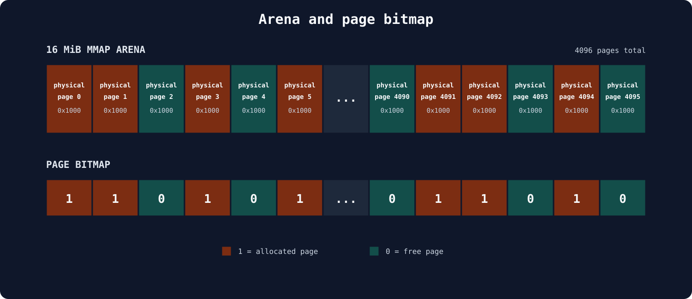

Each chunk of memory above is one physical page from SLOP's point of view. The allocator overview below zooms into those pages and shows how a cache divides each one into objects.

On top of this page allocator sit nine caches, one for each power-of-two size from `0x10` to `0x1000`. A request is rounded up and sent to the matching cache. For example, both a 136-byte spaceship and a 200-byte note are served by the `0x100` cache.

Each cache owns some pages, and each of those pages is divided into equal-sized objects. A `0x100` page contains sixteen objects; a `0x1000` page contains only one.

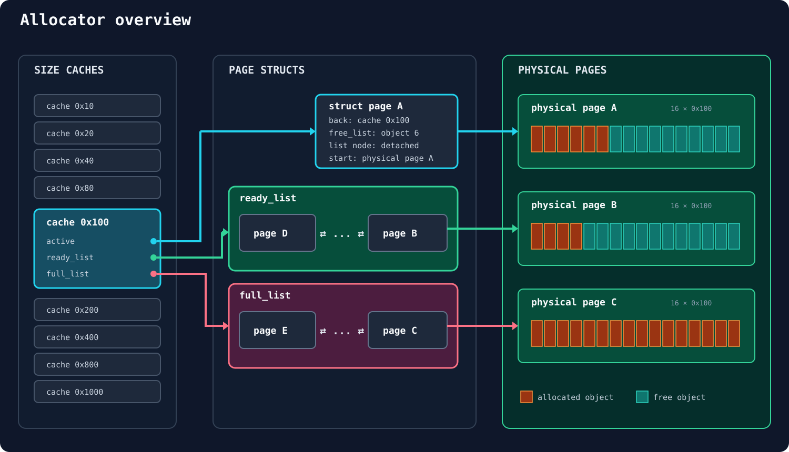

`active` is a direct pointer to one `struct page`. `ready_list` and `full_list`, instead, are doubly linked lists containing multiple page structures. The cache and page metadata live outside the arena; the actual notes and spaceships live in the objects inside it. Every page structure points to its physical page, identifies its owner cache, and stores the head of its freelist.

The freelist is stored inside the free objects themselves. On a fresh `0x100` page, the first object points to the second, the second to the third, and so on. Allocation removes the first object from this chain; freeing an object puts it back at the front. After some allocations and deallocations, we end up in this "current state":

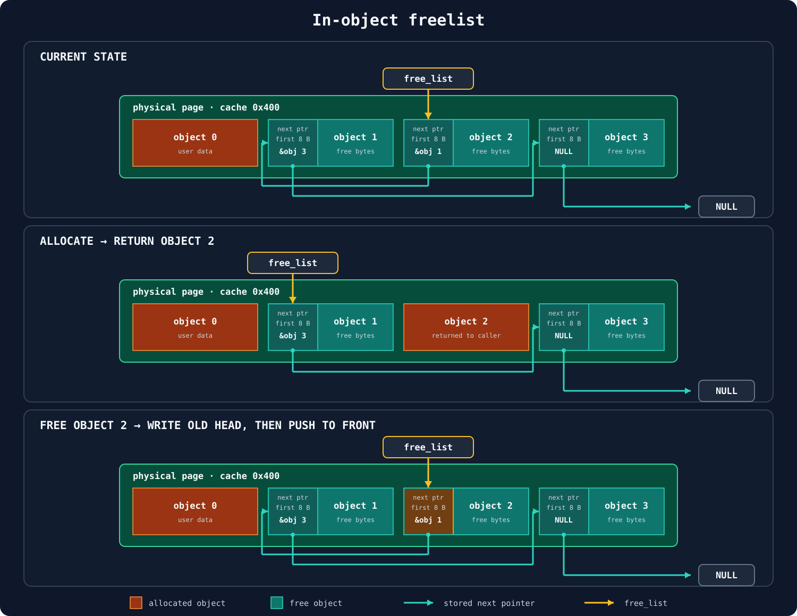

Allocating pops object 2 and advances the head to object 1. Freeing object 2 writes the old head (`&object 1`) into its first eight bytes, then makes object 2 the new head.

### The three page states

A cache divides its pages into three states:

- **active**: the page currently used to satisfy allocations;
- **ready**: a non-active page that still has free objects;
- **full**: a non-active page with no free objects.

There is only one active page per cache. Ready and full pages are kept in doubly linked lists.

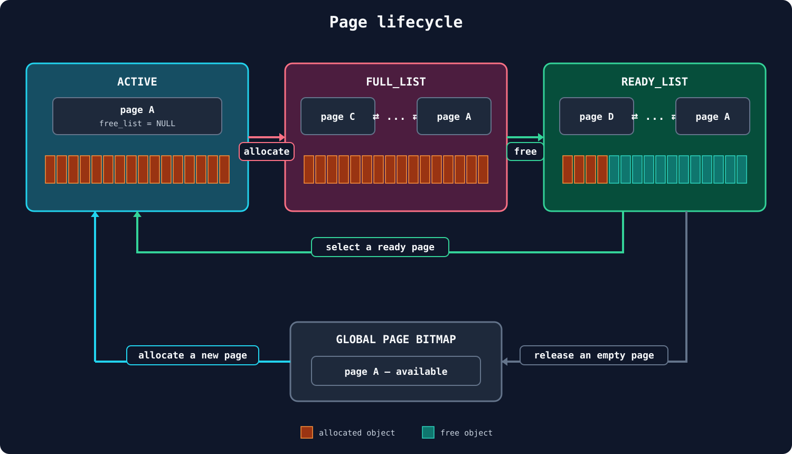

The lifecycle starts when the cache needs an object:

1. If there is no usable active page, SLOP takes an available page from the global bitmap, initializes it for the cache, makes it active, and returns its first object.
2. Further allocations take objects from that active page. When the last free object is returned, the page is full, but it remains the active page for the moment.
3. On the next allocation, SLOP moves the exhausted active page to `full_list`. It then picks the next active page from `ready_list` if one exists; otherwise, it takes another available page from the global bitmap and repeats the first step.
4. Freeing an object that belongs to a page in `full_list` moves that page to `ready_list`, because it can satisfy allocations again.
5. As more objects are freed, a ready page may become completely empty. SLOP keeps a small reserve of ready pages, but once that list reaches its threshold—three pages in this implementation—an empty non-active page can be returned to the global bitmap.

The important detail is the transition from active to full. When the last object is allocated, the page remains active even though its freelist is now empty. It is moved to the full list only when the *next* allocation asks the cache for another object.

This means the following is a valid temporary state:

```text
page is active AND page->free_list == NULL
```

That detail is the entire bug.

## The bug

When an object is freed, SLOP has to decide whether its page was full. The vulnerable code uses this condition:

```c
if (!slop->free_list) {
    list_del(&slop->list);
    slop_cache->full_count--;

    free_slop_obj(obj, &slop->free_list);

    list_add_tail(&slop_cache->ready_list, &slop->list);
    slop_cache->ready_count++;
}
```

The intended meaning is: "if the freelist is empty, this page must be in the full list; remove it from there and put it in the ready list."

But, as we just saw, an active page can also have an empty freelist. The condition should have verified that the page was not the active one:

```c
if (!slop->free_list && slop != slop_cache->active) {
    /* move the page from full to ready */
}
```

If we free an object from a full **active** page, SLOP adds the page to the ready list without clearing the cache's active pointer. The same page is now reachable in two different ways.

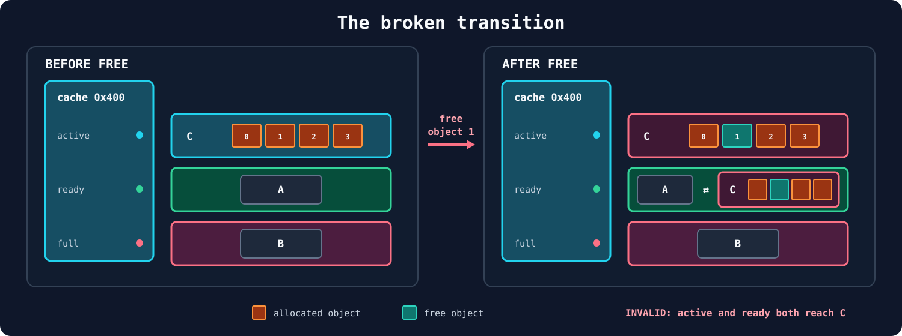

This is already an invalid allocator state, but it is not an overlap yet. The real damage happens during later allocations:

1. The cache allocates through the active pointer, while the page is still linked in the ready list.
2. On the following allocation, the cache sees a full active page and links the same list node into the full list.
3. One `list_head` is now being used by two lists, corrupting both of them.

With the right sequence of allocations and frees, the global bitmap can mark this page as free while the old cache still has a stale path to it. Another size cache may then claim the physical page, even though the first cache can still reach it.

The potential is powerful: two caches with different object sizes can allocate from the same page. An object from one cache can overlap objects from the other.

## Exploitation

Now we can turn that potential into RCE. I will call the three `0x1000` pages used to trigger the bug `A`, `B`, and `C`. Since a `0x1000` page contains one object, allocating or freeing a note also fills or empties its whole page.

### 1. Put the active page in the ready list

We allocate three `0x1000` notes. The first two pages become full; the third is active with an empty freelist:

```text
0x1000 cache
active: C  (full, free_list = NULL)
ready:  empty
full:   A <-> B
```

We then free all three notes. `A` and `B` move normally from full to ready. Freeing `C` triggers the bug because it is active but has `free_list == NULL`:

```text
0x1000 cache
active: C  (also linked in ready)
ready:  A <-> B <-> C
full:   empty
```

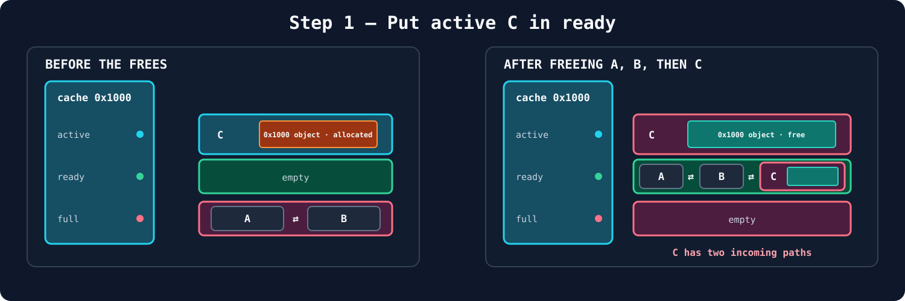

### 2. Return `C` to the bitmap without losing the ready-list path

This is the least intuitive part of the exploit, so let us follow each operation separately.

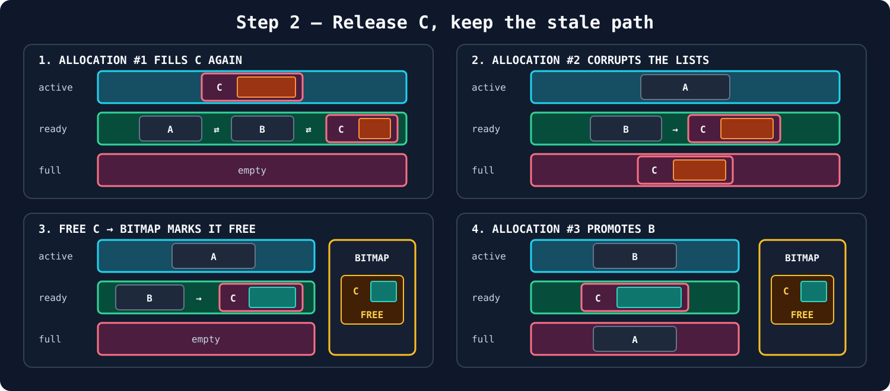

The numbered states in the diagram show the whole sequence:

1. Allocation #1 consumes the object in `C` through `active`. `C` becomes full again, but its node remains linked in `ready`.
2. Allocation #2 links the full active `C` into `full`, then promotes `A` from `ready`. The path through `B` and the `full` list now reach the same `C`.
3. Freeing the first note operates on `C`. `ready_count` reaches three, so `page_free(C)` marks it free in the global bitmap, but the corrupted path from `B` to `C` remains.
4. Allocation #3 moves `A` to `full` and promotes `B` to `active`. `C` is now the next entry in `ready`, even though the bitmap says it is free.

The global allocator and the `0x1000` cache now disagree: one considers `C` available, while the other can still reach it.

### 3. Reuse `C` in the `0x100` cache

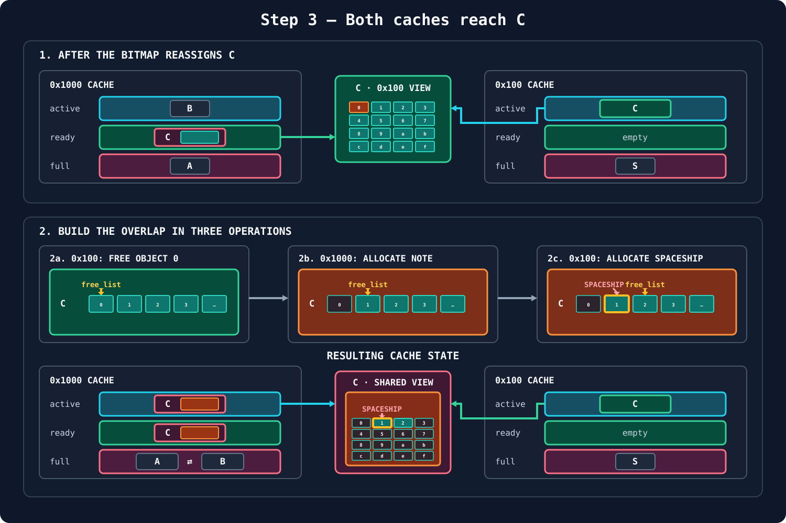

The numbered parts of the diagram show how the overlap is created:

1. The first spaceship already occupies one object in the current `0x100` page, which we call `S`. A second spaceship and fourteen notes fill its remaining objects. The next `0x100` note therefore needs another page: the global bitmap considers `C` free and assigns it to this cache. SLOP reinitializes `C` as sixteen `0x100` objects; object 0 holds the new note and the other fifteen are free. The `0x1000` cache still retains its stale path to `C`.
2. The overlap is built in three separate operations:

   - **2a.** We free the small note in object 0, placing `C + 0x000` at the head of the shared freelist.
   - **2b.** A `0x1000` allocation follows the stale ready-list path to `C`. It consumes object 0 and returns `C + 0x000` as one large note; the shared freelist advances to object 1.
   - **2c.** We allocate a new spaceship from the `0x100` cache. It consumes object 1 at `C + 0x100`, inside the large note, and the freelist advances to object 2.

The result is one `0x1000` object overlapping all sixteen `0x100` objects in `C`.

### 4. Change the permission byte and leak the arena

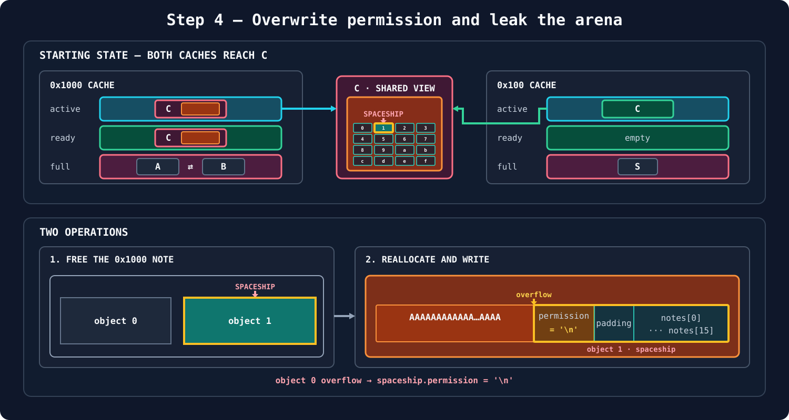

The page-list state does not change during this stage; the two operations only affect the contents of C:

1. We free the `0x1000` note. The metadata in C was last initialized by the `0x100` cache, so `free()` clears only object 0. Object 1, containing the spaceship, survives unchanged.
2. We allocate the large note again and the allocator returns C. We then send 256 bytes followed by a newline. The controlled bytes fill object 0, while `fgets()` stores the newline at `C + 0x100`: the first byte of object 1, making `spaceship.permission = '\n'`. The following NUL byte lands in the struct padding.
At this point, `Take Off` accepts the spaceship because `permission != 0` and prints its address. Since the spaceship is object 1, the leak is `C + 0x100`.

The initial cache setup makes C's position deterministic: it is page 10 of the arena. We can therefore recover the arena base from the leaked spaceship address:

```python
mem_base = spaceship_leak - 10 * 0x1000 - 0x100
```

In the supplied challenge environment, the arena also has a stable offset from libc:

```python
libc_base = mem_base + 0x1000 * 0x1000 + 0x3000
```

This relationship is specific to the provided loader and libc; it is not a general property of `mmap()`.

### 5. Redirect an allocation to `stdout`

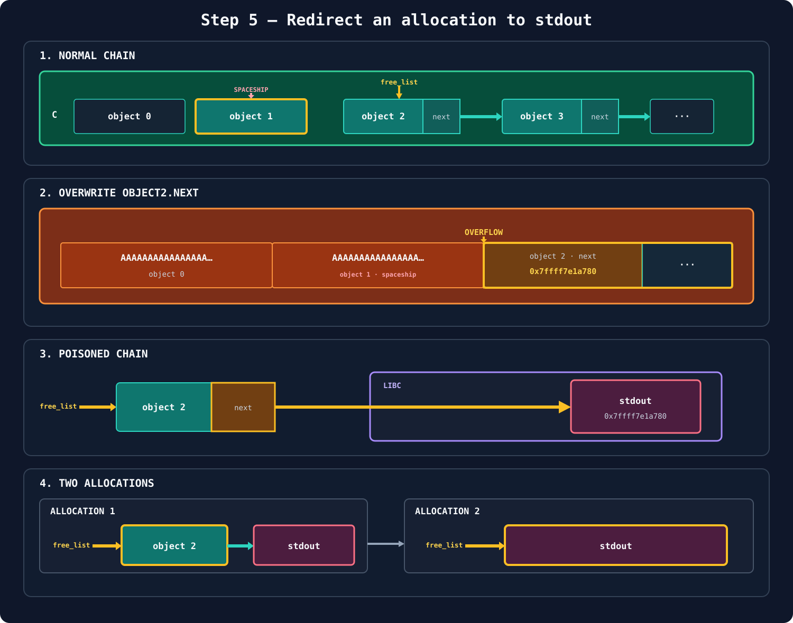

The page-list state is still unchanged. At the object level, the diagram follows the complete change in the `0x100` cache's free-object chain:

1. Before the overflow, `free_list` points to object 2, whose `next` field points normally to object 3.
2. We free and reallocate the large note, then write through object 0 and the spaceship in object 1 until the payload reaches object 2. The `A` bytes represent the controlled part of this write. At `C + 0x200`, we replace `object2.next` with the libc address of `_IO_2_1_stdout_`.
3. The chain is now `free_list → object 2 → stdout`: it leaves page C and reaches the `stdout` `FILE` structure inside libc.
4. The first `0x100` allocation returns object 2 and copies `object2.next` into `free_list`. The list now points to `stdout`, so the second allocation returns that libc address and gives us a controlled `FILE` write.

### 6. Turn the `stdout` overwrite into RCE

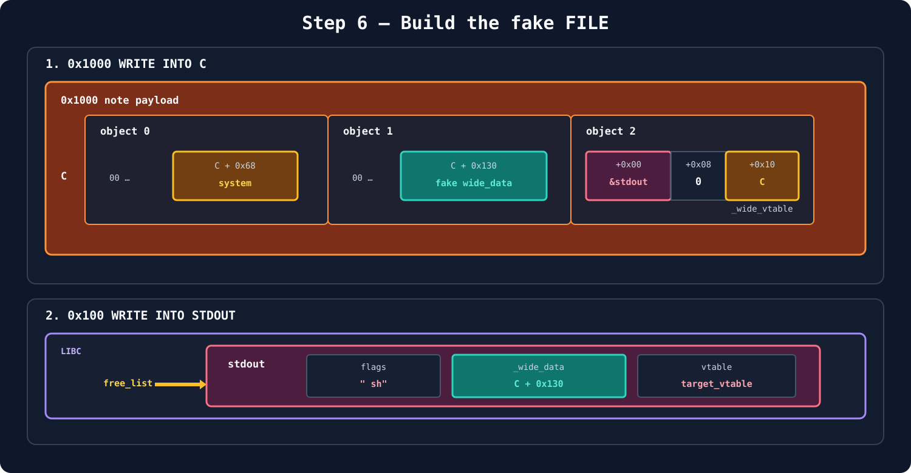

The `0x1000` payload from the previous step was already preparing C for the final FSOP chain:

1. The large-note write stores `system` at `C + 0x68` in object 0. It also creates a zero-filled fake wide-data structure starting at `C + 0x130` in object 1. In object 2, the same payload stores `_IO_2_1_stdout_` at `C + 0x200` for the freelist poisoning and C at `C + 0x210`, exactly where the fake wide-data structure expects its `_wide_vtable` pointer.
2. The first small allocation consumes object 2, moving `free_list` to `stdout`. The second small allocation therefore writes directly over the real `stdout` object. We use it to install the fake `FILE`: the flags begin with `" sh"`, `_wide_data` points to `C + 0x130`, and the vtable selects the required wide-file path.

From there, the standard FSOP path reaches the function pointer stored at `C + 0x68` and effectively calls:

```c
system(" sh");
```

That starts a shell, completing the chain:

```text
active page incorrectly added to ready
    -> corrupted cache lists
    -> stale reference to a released page
    -> same page reused by two size caches
    -> overlapping note and spaceship
    -> arena and libc leak
    -> allocation redirected to stdout
    -> FSOP
    -> RCE
```

## Conclusion

The vulnerable line is small, but the underlying mistake is larger: SLOP infers a page's state from whether its freelist is empty. Those two facts are related, but they are not equivalent.

An explicit state such as `ACTIVE`, `READY`, `FULL`, or `FREE` would make the invalid transition much harder to express. At minimum, the free path must distinguish a full active page from a page that is actually linked in the full list.

This was exactly what I wanted from the challenge. The exploit does not begin with an application-level overflow; it begins by understanding an allocator invariant, breaking it, and following the consequences all the way from page ownership to code execution.
