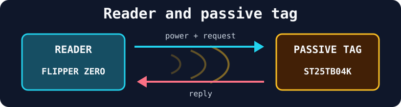
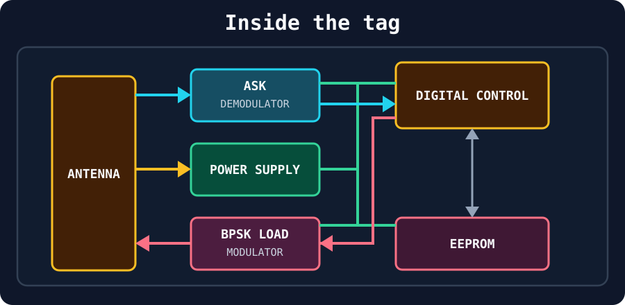
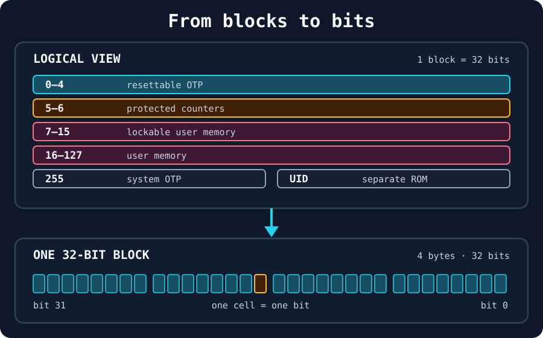
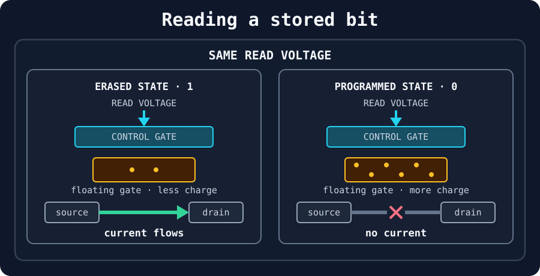
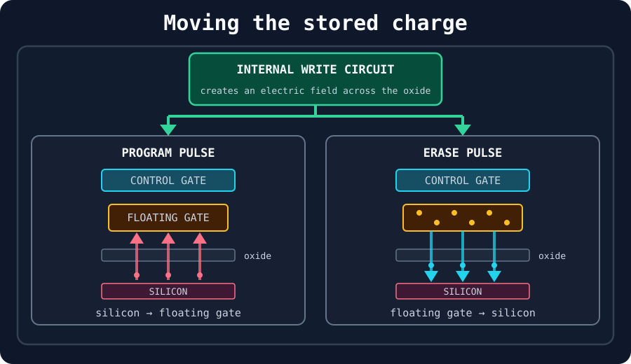
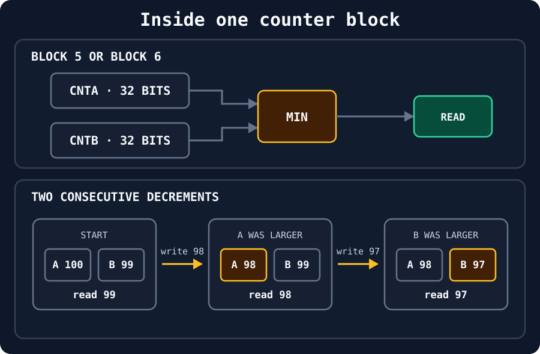
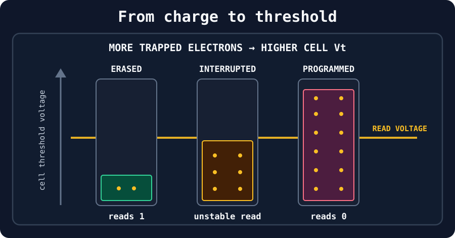
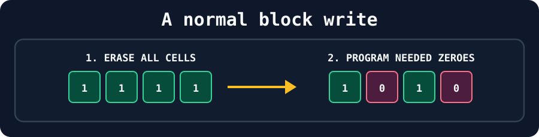
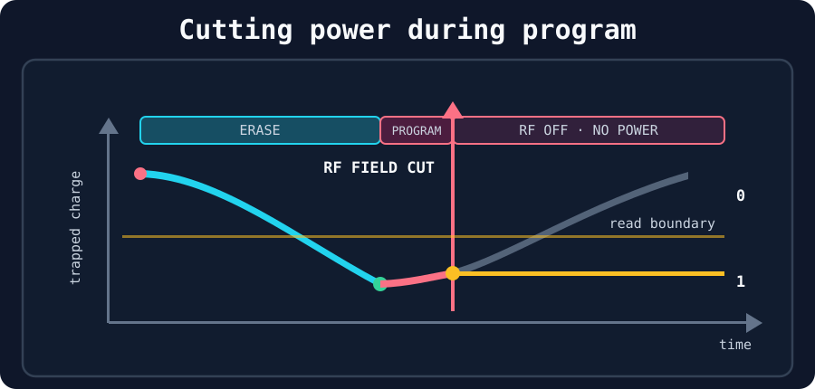
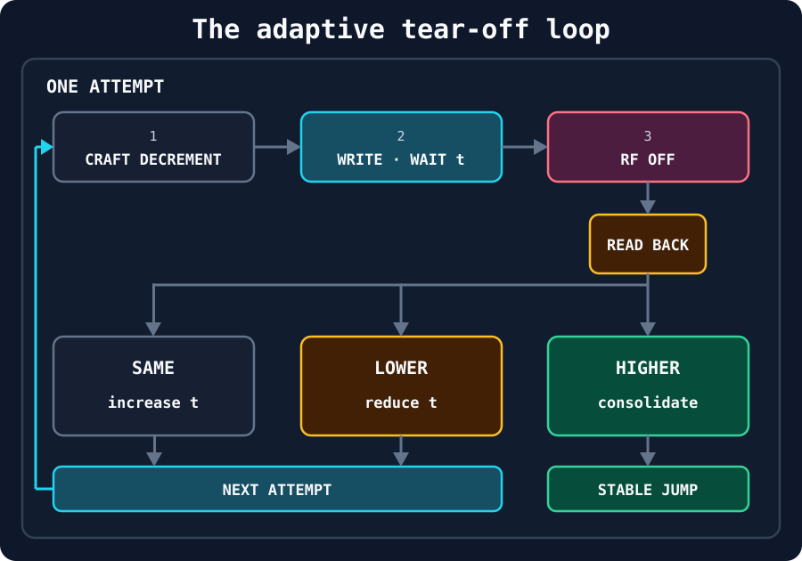

## Introduction

After getting a Flipper Zero, I started experimenting with the NFC (Near Field Communication) tags I had around. Most of them could already be read and written using the available tools, but one family behaved differently: ST25TB. The official NFC application could identify the tag, read its memory, and save it to an `.nfc` file, but it did not offer a way to write that data back. What began as an attempt to fill that small gap eventually became an investigation into the hardware protections of the tag itself.

While researching the protocol, I found Marco Zoratti's article, [*Reverse Engineering: How I hacked vending machines keys with Flipper Zero*](https://marco-zora.medium.com/how-i-hacked-nfc-st25tb-keys-with-flipper-zero-d1a3b1833cf2). His analysis of ST25TB tags and of the information exposed by the Flipper firmware was a useful starting point. I first built a small application for reading, editing, and writing their memory directly from the Flipper. That worked for ordinary blocks, but it also exposed the more interesting boundary of the system: blocks 5 and 6 are monotonic counters that accept only lower values.

At first, I treated that restriction as an absolute hardware rule. Discovering the public research on ST25TB tear-off attacks changed the direction of the project. The question was no longer simply how to send a write command, but how a precisely timed loss of RF power could interrupt an EEPROM operation, create an unstable bit, and ultimately make a decrement-only counter increase.

Answering that question required moving through every layer of the tag: how it receives power, how its EEPROM cells store charge, how its two-copy counter protects interrupted writes, and finally how the Flipper can search for the tear-off time `t`. This post follows that journey, from the first writer to a working experimental implementation of the attack.

> The experiments described here are intended only for tags you own or are explicitly authorized to test. Counter writes are irreversible, tear-off can corrupt the tag, and modifying access, ticketing, or payment systems may be illegal.

## Inside an ST25TB tag

Before writing a single byte, I wanted to understand what I was actually holding. ST25TB is a family of contactless memory tags from STMicroelectronics that run at 13.56 MHz over the ISO (International Organization for Standardization) 14443 Type B interface with a small proprietary command set. The interesting part, however, is not the protocol itself, but the fact that the tag is *passive*: it only exists, electrically, while a reader is powering it. Almost everything surprising about these tags, including the attack later in this post, follows from that one fact, so it is worth looking at the hardware first.

### The radio-frequency field is both power and communication



An ST25TB tag has no battery or other independent power source. The reader (the Flipper Zero here) generates a 13.56 MHz field. When the tag enters that field, it receives the energy needed to operate and can communicate with the reader. Energy travels from the reader to the tag, while information travels in both directions.

The reader sends commands by modulating the field. The tag replies without generating a carrier of its own: it changes the electrical load on its antenna, and the reader detects that variation through inductive coupling.

The [ST25TB04K datasheet](https://www.st.com/resource/en/datasheet/st25tb04k.pdf) lets us identify the main components inside the tag:



Each component has one job:

- **Antenna:** receives the RF (Radio Frequency) energy and the signal carrying the reader's request. It is also the path through which the tag sends its reply.
- **Power supply:** converts the energy collected by the antenna into the voltage needed by the rest of the chip.
- **ASK (Amplitude-Shift Keying) demodulator:** observes the amplitude of the received carrier. The reader encodes its request by changing that amplitude, so the demodulator removes the carrier and reconstructs the stream of request bits.
- **Digital control:** reconstructs and validates the request frame, checks its CRC (Cyclic Redundancy Check), decodes the command and its parameters, and then starts the corresponding memory operation. It also prepares any data that must be returned to the reader.
- **EEPROM (Electrically Erasable Programmable Read-Only Memory):** stores the tag's persistent data. We will open this block in the next section.
- **BPSK (Binary Phase-Shift Keying) load modulator:** receives the reply bits from the digital control and changes the load on the antenna accordingly, allowing the reader to recover the response.

The two blocks that matter most for the rest of the post are the digital control, where a request becomes a memory operation, and the EEPROM, where that operation physically takes place. We will expand both of them later.

### Opening the EEPROM



From the protocol's point of view, the EEPROM is a flat array of 32-bit blocks: every `Read_block` or `Write_block` command moves exactly four bytes. The ST25TB04K has 4 Kbit of user EEPROM, giving 128 addressable blocks. Their behavior is not uniform:

- **Blocks 0–4**: a resettable OTP (One-Time Programmable) area. Individual bits can move from 1 to 0, while a dedicated command resets the entire area to 1.
- **Blocks 5 and 6**: two 32-bit counters that behave unlike anything else on the tag.
- **Blocks 7–15**: user memory that can be permanently locked through the system area.
- **Blocks 16–127**: ordinary user memory.
- **Block 255**: the system area containing OTP and lock bits.

The 64-bit UID (Unique Identifier) is different: it is factory-programmed in a separate ROM (Read-Only Memory), returned by `Get_UID`, and is not part of this EEPROM array.

A `Read_block` returns the four bytes stored at the requested address. For blocks 7–127, a `Write_block` starts a self-timed programming cycle that includes an automatic erase before the new value is written. According to the [ST25TB04K datasheet](https://www.st.com/resource/en/datasheet/st25tb04k.pdf), this takes about 5 ms under typical conditions.

Blocks 5 and 6 are the exception. The hardware accepts a new counter value only if it is **lower** than the current one: they are **decrement-only**, meant for values that must never increase. They also have extra anti-tearing logic to preserve a valid value if power disappears during an update. A normal writer therefore cannot increment them.

### One bit is stored as charge

The ST25TB04K datasheet does not reveal the chip's memory process or transistor-level layout. The following explanation therefore uses the conventional floating-gate EEPROM model to explain the observed behavior.

In that model, a cell is a floating-gate MOS (Metal-Oxide-Semiconductor) transistor. The **floating gate** is the insulated part that stores the bit as trapped charge. The **control gate** does not store anything: it is the electrode to which the chip applies a voltage when it wants to access the cell.



During a read, the chip applies the same known voltage to the control gate in both cases. The charge trapped on the floating gate changes how much control-gate voltage is required to open a conductive channel between source and drain. With less trapped charge, the read voltage is sufficient and current flows: the erased cell is interpreted as **1**. With more trapped charge, the required voltage is higher, the channel stays closed, and the programmed cell is interpreted as **0**.

The stored charge therefore does not travel from source to drain. It changes the condition under which that separate channel can conduct.



Changing the stored bit means changing that trapped charge. The chip's internal write circuitry applies a voltage pulse that creates a strong electric field across the insulating oxide. The direction of that field determines the operation: during **programming**, electrons move from the silicon, through the oxide, and into the floating gate; during **erase**, the field is reversed and electrons move from the floating gate back toward the silicon. The exact voltages and internal circuit are not documented for the ST25TB04K, but this is the conventional EEPROM model represented above.

### Opening the digital control

The frame parsing described earlier is only the entry point. For the rest of this post, the interesting part of the digital control is the rule it applies after decoding a `Read_block` or `Write_block` request for blocks 5 and 6.

Blocks 5 and 6 are the two independent counters exposed by the protocol. Internally, however, **each** logical counter is backed by two 32-bit sub-counters, usually called `CNTA` and `CNTB`. This organization is not described in the datasheet: it was reconstructed from experiments and from a related STMicroelectronics patent.



A read returns the smaller of `CNTA` and `CNTB`. For a write, the digital control first checks that the requested value is strictly lower than **both** copies. If it is not, the request is rejected and no EEPROM update begins. If it is valid, the copy containing the larger value is selected and overwritten. In the example, writing 98 replaces `CNTA`, which held 100; writing 97 next replaces `CNTB`, which still held 99. The two copies therefore take turns moving downward.

This is the counter's anti-tearing mechanism. During a normal decrement, only the larger copy is being changed, while the smaller one still contains the value currently returned by a read. If power disappears before the update completes, that untouched copy prevents an accidentally interrupted operation from becoming an increase.

The distinction between validation and update is essential for the attack. We do not send an illegal increment: we send a value that passes the comparison, let the digital control select one sub-counter and begin its EEPROM update, and then interrupt that physical operation.

## Tear-off: stopping between 0 and 1

The research that motivated this second stage was [*Tears for Fears, Breaking an RFID Counter*](https://www.sstic.org/media/SSTIC2024/SSTIC-actes/tears_for_fears_breaking_an_rfid_counter/SSTIC2024-Article-tears_for_fears_breaking_an_rfid_counter-marty_granier_delion_JHhE6Td.pdf), together with its accompanying [Flipper Zero implementation](https://github.com/SecLabz/flipper-zero-st25-lab). The first intuition behind the attack comes directly from the physical behavior of EEPROM.

The charge stored on a cell's floating gate determines its threshold voltage, Vₜ. During a read, the controller applies a fixed voltage to the control gate and observes whether the channel conducts. The height of each colored rectangle below represents the cell's Vₜ, while the horizontal line represents that fixed read voltage.



After a normal erase or program operation, the cell finishes safely on one side of the read voltage. An erased cell has a lower Vₜ, so the applied voltage opens the channel and the cell reads as **1**. A programmed cell has a higher Vₜ, so the same voltage cannot open the channel and the cell reads as **0**. The transition between those states, however, is gradual: charge must physically enter or leave the floating gate, and that takes time.

Before looking at the interruption, it is important to understand the order of a normal block write. For the ordinary EEPROM area, `Write_block` does not directly change only the bits that differ. It first runs an **erase phase**, bringing all 32 cells in the selected block to their erased state, logical **1**. It then runs a **program phase**, adding charge back only to the cells that must store logical **0**. Bits whose final value is 1 are simply left erased.



The following graph tracks a single cell whose final value must be **0** through both phases.



The erase phase is allowed to finish completely: the trapped charge falls until the cell reaches the erased state and reads as **1**. The program phase then starts adding charge back to the floating gate. We cut the RF field shortly after this second phase begins, while the cell still reads as **1**.

This is where the passive nature of the tag becomes important. Its power comes from the reader's RF field, so disabling the field while an EEPROM operation is still running also removes the power needed to complete it. If the interruption happens at the right instant, the cell can be left close to the threshold instead of reaching either stable state.

The result is a **weak bit**. Its charge level is real and persistent, but it does not express a robust logical value. Small changes in coupling distance, field strength, supply voltage, temperature, or the characteristics of that individual cell may therefore make the same physical bit read first as 0 and then as 1. A tear-off attack begins by deliberately creating this normally invisible intermediate state.

### From a weak bit to a counter jump

The weak bit created above gives us a way to disturb this comparison. If a high-order bit in one sub-counter can be made to read differently under different conditions, the apparent relationship between `CNTA` and `CNTB` changes. A successful tear may consequently expose a value higher than the current counter, but that value is not stable yet: the two copies still disagree. The algorithm must first find the narrow interruption window that creates this state and then consolidate the result with complete writes so that both sub-counters move to the new range.

### Searching for the right `t`

Let `t` be the time between the beginning of a `Write_block` transmission and the instant at which the RF field is switched off. There is no single value of `t` that works for every attempt: the useful window depends on the tag, the cells being changed and the coupling with the reader. Instead of relying on one magic value, we have to search for that window and continuously adapt `t` from the result of the previous write.



- **Craft decrement:** the application reads the counter and constructs a value that the tag is allowed to accept. It must be lower than the current value, otherwise the counter logic would reject it before any EEPROM operation began. Rather than simply subtracting one, the application chooses a bit pattern that makes the write touch useful high-order cells, giving the interrupted program phase a chance to leave one of them erased or weak.

- **Write, wait `t`:** the application sends the `Write_block` command and waits exactly `t`.

- **RF off:** once `t` has elapsed, the Flipper disables its RF field. This interrupts the EEPROM operation and powers the tag down. The field is then restored and the tag is selected again from a clean state.

- **Read back:** the same block is read again and the result determines what happens next:
  - If the value is **unchanged**, the field was removed before the write had a visible effect, so the next attempt slightly increases `t`.
  - If the value is **lower**, the write has started taking effect or has completed normally, so `t` is reduced toward the beginning of the useful window.
  - If the value is **higher**, the tear has produced the jump we were looking for. The value may still depend on a weak bit and on the disagreement between `CNTA` and `CNTB`, so it cannot yet be treated as permanent.

- **Adapt `t`:** these results create a small feedback loop. The application slowly increases `t` while nothing happens, then reduces it as soon as the tag begins to change. In this way, `t` remains close to the boundary between "too early" and "already written", even when that boundary shifts slightly between attempts.

- **Consolidate:** when a higher value appears, the application performs two complete, uninterrupted decrements from it. The first updates one internal sub-counter and the second updates the other. Once both copies have moved into the higher range, their minimum is higher too. A final power cycle and read confirm that the result survives without depending on the weak state. If it is still not above the value from which the experiment started, the same loop continues from this new baseline: each successful consolidation acts like another step of a ratchet.

## Conclusion

What started as a missing write button became a much deeper exploration of the tag. Building the first writer required understanding the ST25TB memory map and its special counter blocks; trying to overcome their restrictions then required going one level lower, from protocol commands to EEPROM cells, trapped charge and the RF field that powers the entire operation.

The tear-off attack is a good example of why that lower level matters. From the protocol's point of view, blocks 5 and 6 are decrement-only. Physically, however, their values are stored in analog cells and protected by two sub-counters whose updates still need time and power to complete. By cutting that power at the right `t`, observing the result and adapting the next attempt, the application can turn an intermediate electrical state into a stable counter increase.

The most interesting part of this project was therefore not the final write itself, but the path from an apparently absolute rule to the physical assumptions beneath it. A passive tag cannot distinguish an accidental loss of power from a carefully timed one, and a digital bit is only the interpretation of an analog state. Once those two ideas came together, the behavior of the attack, and the algorithm needed to reproduce it, became much easier to understand.


<!--
## Building the writer

The application is built with the official Flipper Zero firmware toolchain and uses the NFC implementation already present in the firmware. This keeps the application focused on the missing workflow rather than reimplementing the RF protocol itself.

From the user's point of view, the process is straightforward:

1. Launch ST25TB Writer and choose whether to read a new tag or open an existing `.nfc` capture.
2. Inspect the tag information and navigate through its memory two blocks at a time.
3. Select either block in a row and edit its four bytes with the Flipper's hexadecimal input screen.
4. Select `OK` when the changes are complete and confirm that they should be written.
5. Place the destination tag on the back of the Flipper while the application writes and verifies only the modified blocks.

TODO: capture on the Flipper.


TODO: capture on the Flipper.


TODO: capture on the Flipper.


TODO: capture on the Flipper.


### What happens internally

The first screen offers two sources. **Read** starts an ST25TB poller and reads the tag, including its UID, system OTP value, and all regular memory blocks. **Saved** opens the existing Flipper file browser in the NFC directory, accepts `.nfc` files, and rejects captures whose stored protocol is not ST25TB.

The top of the editor contains the information normally found in the NFC application's `Info` view: the detected variant, the UID, and the system OTP value. The memory follows underneath, with two consecutive blocks on every row:

```text
B000  AA AA AA AA  BB BB BB BB
B002  CC CC CC CC  DD DD DD DD
```

The up and down buttons move between rows, while left and right select one of the two four-byte blocks. Pressing `OK` opens the firmware's native hexadecimal input component for that block. A row marked with `*` contains at least one modified block.

The application keeps the original reading as a baseline, so it knows exactly which blocks changed. After the final confirmation, the writer sends only those blocks to the tag. The operation is driven by NFC poller events rather than a blocking loop: each successful write is read back and verified before the application advances to the next modified address. The destination tag's ST25TB variant is also checked before the first write.

Blocks 5 and 6 are available in the editor and are no longer skipped. They still behave as decrement-only counters at the hardware level. The writer also does not attempt to change the UID or the system block at address 255, and OTP or locked blocks remain subject to their normal restrictions.

The resulting state machine is reflected directly in the interface:

- waiting for a tag;
- reading its complete memory or loading a saved capture;
- editing individual blocks;
- writing and verifying the modified blocks;
- reporting completion, an incompatible tag, or the block at which writing failed.

The [source code and build manifest](https://github.com/GATT0/ST25TB-Flipper-Writer) live in a separate repository so that the article can focus on the behavior and design rather than becoming a walkthrough of the C implementation.

### Current limitations

Edits currently live only in memory. Opening a saved capture provides its initial values, but the application does not overwrite or create an updated `.nfc` file. The edited data can be written to a physical tag, then read again with the standard NFC application if a new capture is needed.

The editor covers the normal addressable blocks, including the two counters, but deliberately leaves the UID and system OTP block read-only. It also cannot determine that an apparently writable value will be accepted in every case: OTP transitions, lock bits, and counter rules are enforced by the tag itself. Read-back verification is therefore the final authority on whether a change succeeded.
-->
